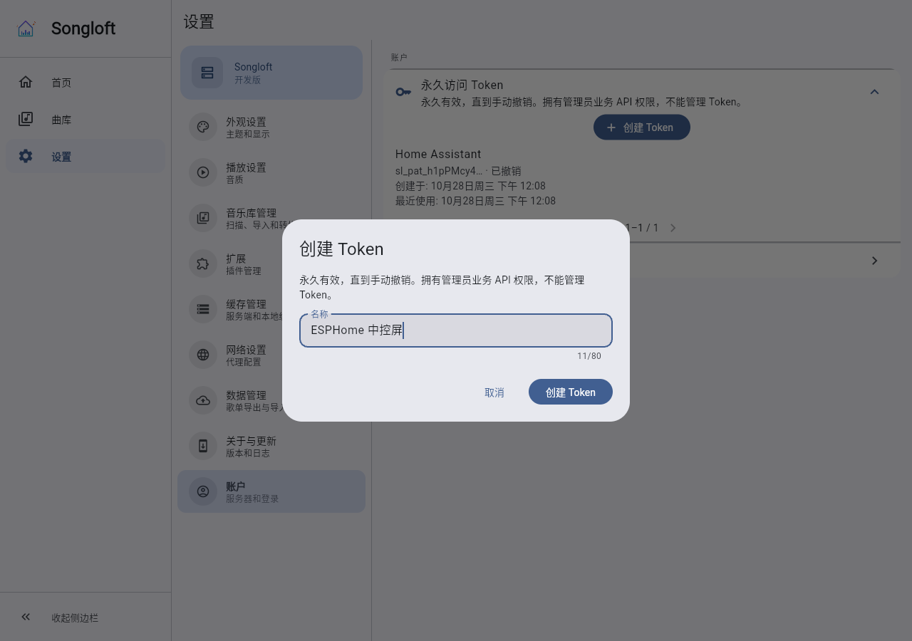
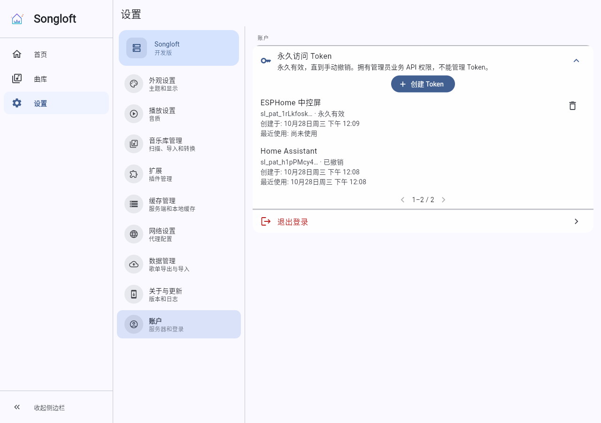
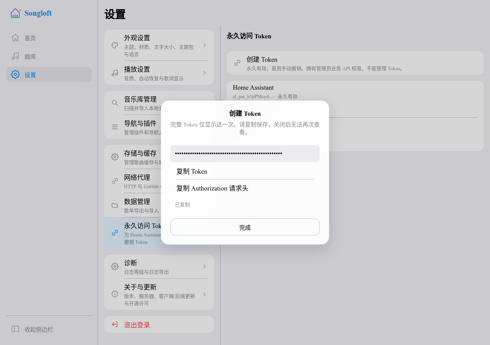
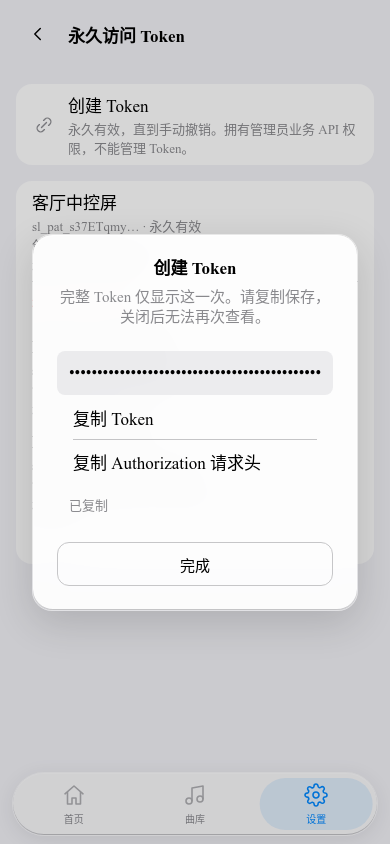

# 永久访问 Token（songloft-org/songloft#546）

支持在 Flutter「设置 → 账户 → 永久访问 Token」与 Lynx「设置 → 永久访问 Token」为设备创建独立凭证，一次性复制完整 Token 或 Authorization 请求头，并查看创建时间、最近使用时间、撤销状态和分页列表。数据库仅保存哈希；没有到期时间，退出客户端和服务重启后继续有效。完整接口和失效语义见 [API 规范](api_response.md)。

## 实现与边界

- `0045_personal_tokens.sql` 创建独立表（合入时因迁移编号与本地库冲突，由上游的 0040 重编）；固定 SQL 由 sqlc 生成，通过认证仓储访问。
- 使用 `crypto/rand` 生成 32 字节凭证，`sl_pat_` 前缀，存 SHA-256 哈希；列表只返回管理 ID、名称、短前缀、时间及撤销状态。
- 每次认证检查数据库，撤销影响后续请求；最近使用时间最多每分钟写一次。每枚令牌有独立 ClientID，兼容按客户端隔离的媒体会话。
- 业务 API 支持 Bearer 请求头和 `access_token` 查询参数。现有与新增 Token 管理及退出登录接口仅接受正常登录的 Access Token，拒绝插件、永久和 Refresh Token。
- 两客户端只在弹窗的临时状态持有完整凭证。Lynx 不将创建响应放入 Query/Mutation 缓存；Flutter 屏蔽新接口的调试日志。复制失败保留弹窗，允许重试或手动选择。
- 首版授予管理员业务 API 权限，未实现细粒度 scope、自动轮换或修改有效期。

## 验证对象

2026-10-28，Linux x86_64，Go 1.26.0、Node 22.17.1、pnpm 11.15.1、Flutter 3.44.8、FFmpeg 5.1.7。测试对象是以下基线加本次未提交工作树：

| 仓库 | 基线 |
| --- | --- |
| songloft-org/songloft | `022a56cebe4b4b6bc1ff7ca043f56d426bddaf71` |
| songloft-org/songloft-player | `224fec0f74f31139761935c612e1ceb8d8e24717` |
| songloft-org/songloft-player-lynx | `1d9317a87ef2967b6acfd90ba6ac8b731fbe5c48` |

最终源码指纹与验证日志索引：`/tmp/songloft-546-verification.json`。指纹覆盖 tracked diff 与 untracked 源码内容，不含本说明及进展/交接文档，避免记录自引用。

客户端交付提交：Flutter `3941eca`，Lynx `29ebc94`（含前置 Markdown 夹具修正 `26b5a99`）。父仓库同步这两个 gitlink，并将下方实际截图入库供 Issue 回复引用。新一轮完整验证日志使用 `/tmp/songloft-546-review-*.log`；最终 793 项 Flutter、3724 项 Lynx、89 项 Lynx 发布工具及后端全量测试和 vet 均通过。

## 检查结果

- 后端 `CGO_ENABLED=0 go vet -tags dev,lite ./...`、同标签全量 `go test`、新增服务/HTTP 用例的 race 检查通过；最终认证路由变化后追加 app/handlers/middleware 检查通过。59 项脚本测试通过。已运行 `gofmt -w .`、`make sqlc`、`make swagger`，Swagger 包含新路径和响应模型。
- 新用例覆盖名称校验、凭证隔离、哈希存储、真实分页、节流更新时间、服务实例重建、立即撤销、重复撤销、管理接口身份限制，以及请求头/查询参数认证。在隔离 Go overlay 中移除撤销检查或登录身份检查，对应测试均按预期失败。
- Flutter 最终工作树重新运行静态分析和全量 793 项测试，均通过；Web release 构建和真实浏览器流程通过。新增测试包含创建、两种复制、复制失败恢复、关闭后隐藏凭证、确认撤销和调试日志不泄露凭证。
- Lynx 类型检查、双 bundle 和 embedded Web 构建通过。首轮全量测试有两项旧 Markdown 夹具失败：发布模板已精简为一行链接，而测试仍断言旧标题和表格。改为独立双语表格夹具后保留原有断言，最终 352 文件 / 3724 项全部通过，89 项发布工具检查也通过；没有跳过或放宽检查。
- 真实 HTTP 临时数据库验证：退出登录后设备凭证仍可用；停止、重新启动服务后两枚凭证仍可用；撤销一枚立即返回 401，另一枚返回 200；管理接口返回 403，列表与数据库无完整凭证。

浏览器操作证据记录在 `/tmp/songloft-546-{lynx,flutter}-ui-result.json` 与对应 PNG；重启证据为 `/tmp/songloft-546-restart-result.json`。测试媒体为缓存目录中生成的 2 秒合成音频及内嵌封面，未使用私人曲库。

Docker Chrome 中两客户端均实际完成创建、复制完整 Token/请求头、关闭后隐藏凭证、确认撤销及撤销后 401；Lynx 还验证带查询 Token 的真实封面下载（200 / 248 字节）。浏览器开启剪贴板权限并保持页面焦点，未用模拟剪贴板代替。Flutter 列表时间随后改为本地化日期/分钟，追加相关测试及构建/浏览器验证。Go 的 dev 完整嵌入构建和 dev,lite 构建均通过。

Lynx 在 1280×900 和 390×844 两种浏览器窗口完成相同流程，覆盖主从面板与移动路由；窗口尺寸验证不外推为移动真机。完整嵌入 Go 服务在 `/music` 子路径下实际返回首页、创建永久 Token 并以查询凭证访问歌曲接口成功，证据 `/tmp/songloft-546-full-smoke-result.json`。

## 实际界面截图

本轮使用中文界面、隔离测试账号和合成媒体，重新完成创建、复制 Token / Authorization 请求头、关闭后隐藏凭证、封面下载与撤销后 401。复制截图仅将浏览器中的 Token 输入框临时切换为密码显示，不改变凭证值；没有保存完整凭证。截图中的设备名称是测试数据。

## Not run

报告人的群晖、实际 Home Assistant / ESPHome 固件、MIoT 真音箱，以及 Android/iOS/HarmonyOS/桌面原生宿主的编译与设备验证未运行；浏览器与共享源码测试不替代这些验收。本批已获提交、推送和回复 #546 的授权，按子仓库先、父指针后的顺序交付；正式发布与关闭 Issue 不在授权内。实际 SHA、CI 和回复以 GitHub 交付记录为准。
